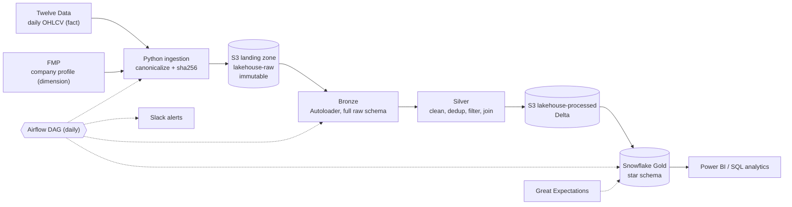

# Modern Lakehouse: Batch ELT Pipeline (Stock Market Edition)


A production-style **batch ELT pipeline** that ingests real, relationally linked financial data from two APIs, lands it immutably in S3, refines it through a **Bronze -> Silver** medallion in Databricks, and serves it from a **Snowflake star schema**. Orchestrated by Airflow, tested with Great Expectations, shipped with GitHub Actions. The whole thing runs inside a single GitHub Codespace.

## Architecture




## Key decisions at a glance

| # | Decision | Why it matters |
|---|---|---|
| 1 | **Content-hash filenames** in an immutable landing zone | Identical reruns are a no-op; changed data gets a new key; Autoloader never silently skips. |
| 2 | **Hybrid Snowflake load**: MERGE for dim/fact, static dim_date | Compute stays flat as the fact table grows; reruns are safe. |
| 3 | **Twelve Data + FMP joined on `symbol`** | A real shared key, not a manufactured one. |
| 4 | **Filter only at Silver** (Option A) | Bronze is the insurance policy: nothing is ever dropped before analytics judgment. |
| 5 | **Codespace + Docker Compose**, no VM | One command, reproducible, zero infra to babysit. |
| 6 | **Auto-stub (inferred member)** for early-arriving facts | No silent data loss, no `-1` orphan keys; self-heals when the profile arrives. |
| 7 | **Autoloader `availableNow`**, one checkpoint per source | Incremental machinery, genuinely batch behaviour, independent failure domains. |
| 8 | **Layered idempotency** | Each layer guarantees what it is cheapest to check. |

Full reasoning: [docs/DECISIONS.md](docs/DECISIONS.md).

## Data sources

| Source | Role | Free tier |
|---|---|---|
| Twelve Data `/time_series` | Daily OHLCV prices (**fact**) | 800 req/day, 8 req/sec |
| FMP `/stable/profile` | Company profile (**dimension**) | 250 req/day |

## Pipeline flow

1. **Extract**: canonicalize -> sha256 -> write the *original, untouched* payload to `s3://lakehouse-raw/{source}/dt=YYYY-MM-DD/<hash>.json`
2. **Bronze**: Databricks Autoloader, full raw schema plus `_ingested_at`, `_source_file`, `_rescued_data`
3. **Silver**: PySpark clean, dedup, filter, join on `symbol`, write Delta to `s3://lakehouse-processed/`
4. **Gold**: Snowflake external stage + high-water mark, MERGE into `dim_company` and `fact_stock_prices`
5. **Validate**: Great Expectations against Snowflake
6. **Notify**: Slack success / failure / quality-failure messages

## Business questions answered

Performance comparison, sector-relative performance, volatility ranking, volume anomaly detection, exchange breakdown, candlestick trends, IPO-age vs volatility. These exercise window functions (moving averages, day-over-day %, rank within sector).

## Repository layout

```text
modern-lakehouse-batch/
|-- .devcontainer/        Codespace definition
|-- .github/workflows/    ci.yml, deploy.yml
|-- airflow/dags/         lakehouse_pipeline_dag.py
|-- bronze/               autoload_bronze.py
|-- docs/                 architecture, ADRs, schemas, problems faced
|-- infra/terraform/      S3 + IAM
|-- ingestion/            canonical_hash.py, twelvedata_ingest.py, fmp_ingest.py
|-- sql/ddl, sql/load/    Snowflake DDL and MERGE scripts
|-- tests/                Great Expectations checks
|-- transformation/       spark_transform.py (Silver)
|-- docker-compose.yml
`-- requirements.txt
```

## Documentation

| Doc | Contents |
|---|---|
| [Architecture](docs/ARCHITECTURE.md) | Stack, phases A/B, medallion rules, scalability |
| [Decisions (ADRs)](docs/DECISIONS.md) | Every locked decision with context and consequences |
| [Data sources](docs/DATA_SOURCES.md) | Raw schemas, relationship, business questions |
| [Star schema](docs/STAR_SCHEMA.md) | ER diagram, grain, keys, load strategy |
| [Problems faced](docs/PROBLEMS_FACED.md) | The TSLA early-arriving fact, Docker-in-Docker fix |
| [Roadmap](docs/MILESTONES.md) | Nine milestones with status |

## Quick start

1. Open the repo in **GitHub Codespaces**.
2. Add secrets in Codespace settings: `AWS_ACCESS_KEY_ID`, `AWS_SECRET_ACCESS_KEY`, `SNOWFLAKE_USER`, `SNOWFLAKE_PASSWORD`, `SNOWFLAKE_ACCOUNT`, plus the two API keys. Never put secrets in `.env`.
3. `docker-compose up`, then open Airflow on port 8080 and the Spark UI.
