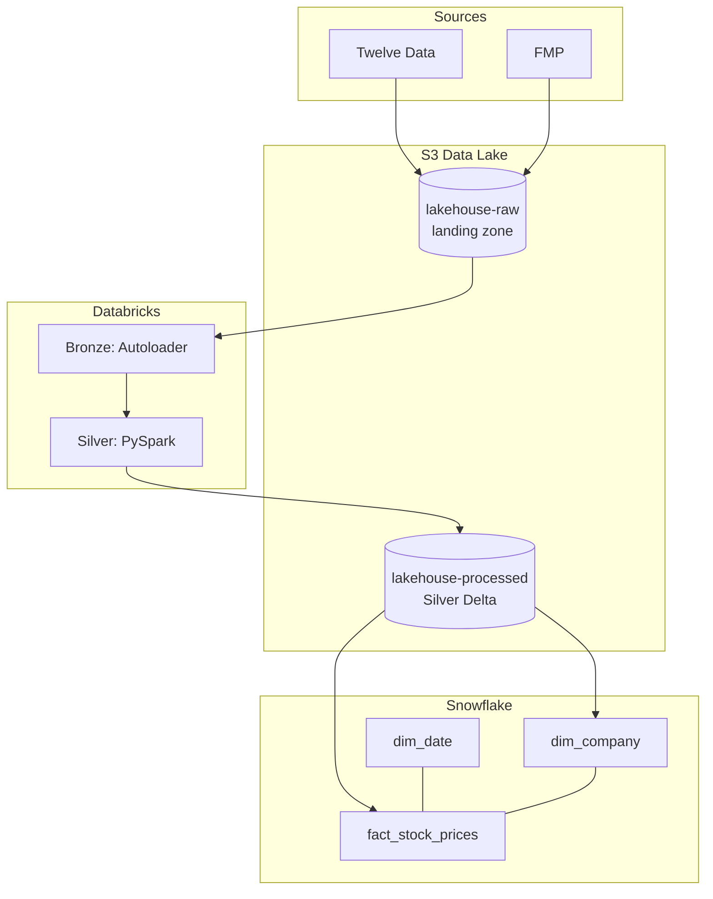

# Architecture



## Stack

| Layer | Tool | Purpose |
|---|---|---|
| Sources | Twelve Data, FMP | Real, relationally linked financial data |
| Lake | Amazon S3 | Immutable landing zone + Silver Delta |
| Orchestration | Airflow (Docker Compose, LocalExecutor + Postgres) | Scheduling and dependencies |
| Dev/run env | GitHub Codespaces | Reproducible, single `docker-compose up` |
| Processing | Databricks (PySpark, Delta Lake, Autoloader) | Bronze ingestion, Silver transform |
| Warehouse | Snowflake | Star schema |
| Data quality | Great Expectations | Automated validation gates |
| CI/CD | GitHub Actions | Lint, test, deploy |
| IaC | Terraform | S3 buckets and IAM |
| Alerting | Slack incoming webhook | Success / failure notices |

## Phase A: manual, layer by layer

Each layer is run and verified by hand before anything is automated.

```bash
python ingestion/twelvedata_ingest.py
python ingestion/fmp_ingest.py
databricks jobs run-now --job-id <bronze_job_id>
databricks jobs run-now --job-id <silver_job_id>
snowsql -f sql/load/load_dim_company.sql
snowsql -f sql/load/load_fact_stock_prices.sql
pytest tests/test_quality_checks.py
```

Verification at every step: rerun twice, confirm zero new files (landing), zero new rows (Bronze), unchanged row counts (Gold).

## Phase B: orchestrated

Identical scripts and idempotency; only the trigger and failure handling change.

```text
[ingest_twelvedata, ingest_fmp] -> run_databricks_transform -> load_to_snowflake -> run_data_quality_checks -> send_completion_alert
```

Daily schedule, `catchup=False`. A critical quality failure halts the DAG. A separate weekly reconciliation compares S3 Silver with the Snowflake fact table.

## Medallion rules

| Layer | Rule |
|---|---|
| Landing zone | Immutable. Original payload, nothing filtered, nothing moved. |
| Bronze | Full raw schema + `_ingested_at`, `_source_file`, `_rescued_data`. Append-only, still "dirty". |
| Silver | First layer with judgment: clean, dedup, filter, join on `symbol`. |
| Gold | Modeled star schema in Snowflake. |

## Scalability

| Layer | Scales by |
|---|---|
| Landing zone | Adding source folders; date partitions keep file counts small |
| Ingestion | Running more stateless scripts in parallel |
| Bronze | Autoscaling; cost follows new files, not history |
| Silver | Cluster size / autoscaling |
| Gold | Warehouse resizing; MERGE keeps per-run cost flat |
| Airflow | LocalExecutor -> CeleryExecutor without rewriting tasks |

Core principle: every layer is stateless and re-runnable; idempotency is enforced where it is cheapest to check.

## Environment notes

- Codespace runs Docker Compose (Airflow: Postgres + LocalExecutor; Spark: master + worker).
- `devcontainer.json` installs Python, Java 17, Terraform, and Docker via docker-outside-of-docker (`moby: false`).
- Secrets only in Codespace / GitHub Secrets. `.env` holds non-secret config only.
- `airflow/logs/`, `.terraform/`, `*.tfstate` are gitignored.
- Terraform state is local: a known, accepted limitation for a single-developer project.
