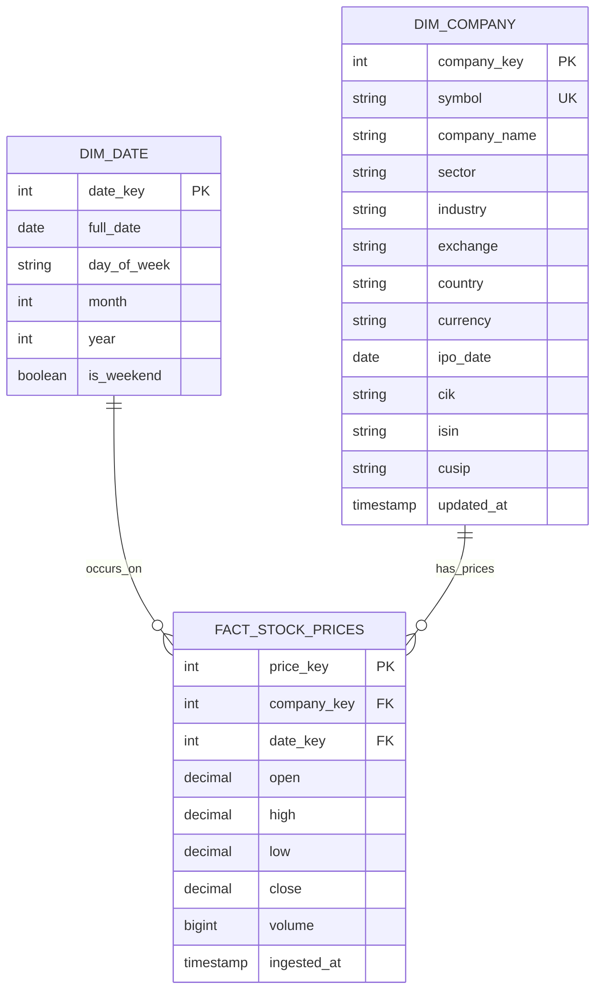

# Gold Star Schema

**Grain:** one row = one company, one trading day.

## Integrity rules

- `fact_stock_prices.company_key` -> FK -> `dim_company.company_key` (NOT NULL)
- `fact_stock_prices.date_key` -> FK -> `dim_date.date_key` (NOT NULL)
- `dim_company.symbol` is UNIQUE and NOT NULL: the natural key shared by both APIs
- The fact table uses the surrogate `company_key` for join performance, not the natural key

## Load strategy

| Table | Strategy |
|---|---|
| dim_company | MERGE on `symbol` (SCD Type 1) |
| dim_date | Static, built once |
| fact_stock_prices | Stub missing companies, then MERGE on `(company_key, date_key)` |

See [ADR 2](DECISIONS.md#adr-2) and [ADR 6](DECISIONS.md#adr-6).
